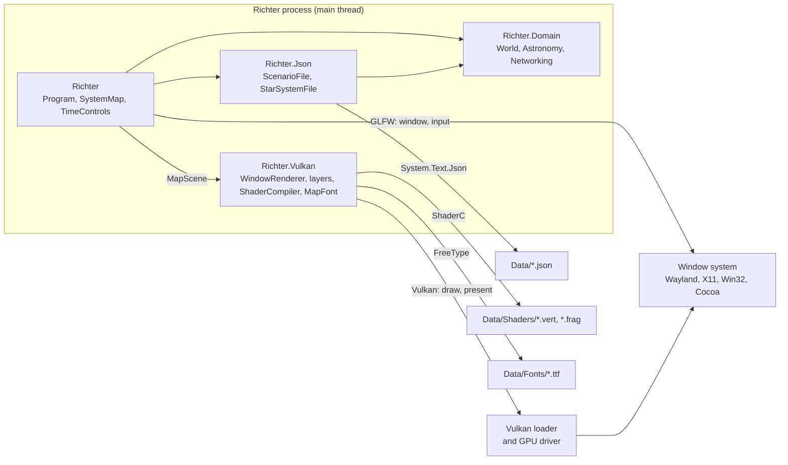

# Richter architecture

Richter is a standalone game built on BRUTAL, a set of C# bindings over native libraries. It
uses GLFW for windows and input, and Vulkan for rendering. Richter owns all of its state: there
is no server, database or other system it mirrors. `Richter.Domain` holds the game model: a
`World` with its star system, the networks placed in it, and the clock. It works out where every
body and location is at any instant, whether two locations can see each other, whether each link
is up and how slow it is, and the fastest route between networks. The game reads its content
from hand-editable files in `Data/`, including the networks and links a game starts with, runs
the clock in real time, and draws a labelled top-down map of the star system and its networks.
Nothing is saved yet.

## Components

| Part | Where | Does |
|---|---|---|
| `Program` | `Richter/` | Composition root. Loads the content, starts GLFW, creates the window, `World` and renderer, runs the loop, shuts down. |
| `SystemMap` | `Richter/` | The map view: focus (Tab, Shift+Tab) and zoom (scroll), and the `MapScene` for each frame. |
| `TimeControls` | `Richter/` | Space pauses, + and - step the time scale from ×1 to ×1,000,000. |
| `GlfwSurfaceSource` | `Richter/` | `IVulkanSurfaceSource` over a GLFW window. Also points GLFW at Brutal's Vulkan loader. |
| Game data | `Richter/Data/` | Hand-written content copied next to the executable: `scenario.json` (start time, networks, devices, links), `solar-system.json`, the GLSL in `Shaders/`, and the label font with its licence in `Fonts/`. |
| `WindowRenderer` | `Richter.Vulkan/` | Owns the Vulkan instance, device, VMA allocator, `Swapchain` and the layers, and draws a `MapScene` each frame. `ShaderFiles` lists the shaders the layers need. |
| `LineLayer`, `DiscLayer`, `TextLayer` | `Richter.Vulkan/` | The `IMapLayer`s, drawn in that order. Each owns its pipeline, its buffers and the names of its two shaders; `TextLayer` also owns the font atlas. `LayerPipeline` builds their pipelines. |
| `MapScene` | `Richter.Vulkan/` | One frame's lines, discs and labels, in pixels from the window's centre. |
| `MapFont`, `LabelLayout` | `Richter.Vulkan/` | FreeType rasterises the font into an atlas at start-up, through the hand-written bindings in `FreeTypeNative`. Labels become glyph quads on whole pixels; one that would overlap a label placed earlier is dropped. |
| `ShaderCompiler` | `Richter.Vulkan/` | Compiles GLSL to SPIR-V with ShaderC at start-up. |
| `IVulkanSurfaceSource` | `Richter.Vulkan/` | The only view the renderer has of the window: extensions, size, surface creation. |
| `World` | `Richter.Domain/` | The root of game state: the star system, the network graph, the time and the time scale. |
| Astronomy | `Richter.Domain/Astronomy/` | `StarSystem` of `CelestialBody`s with their `Orbit` and `Rotation`, and `Location`s on or around them. `StarSystem` gives positions (`Vector3D`, metres), orbit paths and line of sight. `IauRotation` converts published spin elements. |
| Networking | `Richter.Domain/Networking/` | `NetworkGraph` owns every `Network`, `Device` (one `Gateway` per network) and `Link`. `DelayOf` says whether a link is up and how slow it is; `FindRoute` gives the fastest `Route`. |
| `StarSystemFile`, `ScenarioFile` | `Richter.Json/` | Read content files into the domain: the star system, then a `World` in it with the scenario's networks, devices and links. The records in `Documents/` are the file formats; `ContentErrors` words errors for players and modders. |
| Tests | `Richter.Tests/` | xUnit v3 tests of mistakes that stay quiet at runtime, on Microsoft.Testing.Platform. |

References point inward: `Richter` → `Richter.Vulkan`, `Richter.Json` and `Richter.Domain`, and
`Richter.Json` → `Richter.Domain`. `Richter.Vulkan` references no other project and never GLFW:
`MapScene` is all it knows of the game. File formats stay in `Richter.Json`, and
`Richter.Domain` references nothing and uses no native packages. Things with identity (bodies,
networks, devices, links) are classes and refer to each other by ID; values (orbits, rotations,
locations) are records. Bodies only come from content, so a body's ID is the key its file gives
it, such as `earth`. Networks, devices and links can be made during play, so `NetworkGraph`
numbers them from one counter, in the order they're made.

## Start-up and shutdown

1. `Program.Main` loads `solar-system.json` through `StarSystemFile`, then `scenario.json`
   through `ScenarioFile`, which starts the `World` and adds its networks, devices and links
   through `NetworkGraph`. It compiles the shaders that `WindowRenderer.ShaderFiles` lists
   through `ShaderCompiler` and rasterises the font through `MapFont`, all before touching GLFW.
   It reports every broken file and returns 1 without opening a window.
2. It calls `GlfwSurfaceSource.ShareVulkanLoader`, then `Glfw.Init`.
3. `Program.Run` creates the window with `ClientApi = GLFW_NO_API`, because Vulkan draws to
   it.
4. `WindowRenderer` creates an instance, a surface, a Vulkan 1.3 device with dynamic rendering
   on the first device with one queue family that can both draw and present, a VMA allocator,
   the `Swapchain`, and the layers, which build their pipelines for the swapchain's format.
   `TextLayer` uploads the font atlas through a staging buffer and waits for the copy.
5. Closing the window sets `ShouldClose`. `Run` returns, and its `using` declarations dispose
   the renderer (which waits for the GPU) and then the window. `Main` calls `Glfw.Terminate`
   in a `finally`.

## A frame, end to end

1. `Program.Run` advances the `World` by the real time since the last frame (`Stopwatch`), even
   while minimised, and updates the window title when it changes.
2. At a zero framebuffer size (minimised) it calls `Glfw.WaitEvents` and draws nothing.
   Otherwise `Glfw.PollEvents` delivers key and scroll events to `TimeControls` and `SystemMap`.
3. `SystemMap.Draw` fills the `MapScene`: orbit paths for bodies and satellites from
   `StarSystem.OrbitPathOf`, links (green while `DelayOf` says they're up), then bodies and
   networks as discs with labels, the focused body's first. Each position is taken relative to
   the focused body before it becomes a `Single` pixel.
4. `WindowRenderer.DrawFrame` rebuilds the swapchain if it's out of date or the framebuffer size
   changed, waits on `_frameFence` (one frame in flight), and acquires an image. If the
   swapchain is out of date it flags a rebuild and skips the frame, leaving the fence signalled.
5. It resets the fence, and each layer writes its part of the scene into its `MappedBuffer`
   (`TextLayer` lays out the labels with `LabelLayout` first). It records a barrier to
   `ColorAttachmentOptimal`, a dynamic rendering pass that clears and sets the viewport, in
   which each layer binds its pipeline, pushes half the framebuffer size and draws, and a barrier
   to `PresentSrcKHR`.
6. The submit waits on `_imageAvailable` and signals the image's render-finished semaphore and
   the fence. `PresentKHR` waits on that semaphore; a suboptimal or out-of-date result flags a
   rebuild.

## A position, a link delay and a route, end to end

1. `StarSystem.PositionOf(location, time)` adds the location's offset to its body's position:
   the parent's position plus `OrbitMotion.PositionAt`, up to the root at the origin. Body
   positions are kept for the last instant asked about, because one frame asks for them once
   for every link.
2. `OrbitMotion` moves the mean anomaly on at the mean motion and solves `Kepler`'s equation. An
   orbit against its parent's equator is turned into the system frame by `BodyFrames`.
3. `BodyFrames.SurfaceToSystem` turns a `SurfaceLocation` with its body's spin.
4. `HasLineOfSight` checks the straight line against every body as a sphere.
5. `NetworkGraph.DelayOf` hands the link to `SignalPropagation`: a cable's delay is its length
   along the ground at two-thirds of light speed; a beam is up when nothing blocks it and the
   other end is 10° above any ground station's horizon, and its delay is distance over light
   speed. No delay is stored, so none is ever stale.
6. `NetworkGraph.FindRoute` runs Dijkstra's algorithm in `RouteFinder`, with each link's delay as
   its length, skipping links that are down. It tries links in ID order, which is the order they
   were made, so equal routes come out the same every run.

The accuracy is a game's: bodies are spheres with fixed poles and constant spin, and orbits are
fixed ellipses that nothing disturbs. The planets are within about a degree of where they really
are, and the Sun and the Moon's phases keep time for centuries. That's deliberate: there are no
ephemeris files, precession or leap seconds. The start time comes from `scenario.json` and will
change, so nothing may depend on the year.

## Background work

None: there are no other threads, events or schedules. GLFW delivers input through callbacks
during `Glfw.PollEvents` or `Glfw.WaitEvents`. The GPU runs at most one frame behind the CPU,
held there by `_frameFence`. Game time moves only when `Program.Run` calls `World.Advance`.
`StarSystem` keeps body positions between calls, which is safe only because everything runs on
the main thread.

## Where the rules are enforced

- **Threading:** all GLFW calls happen on the main thread, in `Program`.
- **Layering:** project references enforce the dependency direction. The renderer sees the
  window only through `IVulkanSurfaceSource`.
- **Swapchain validity:** `WindowRenderer.DrawFrame` decides when to rebuild, and `Swapchain`
  rebuilds.
- **Network rules:** `NetworkGraph` is the only way to add or remove networks, devices and
  links: one gateway per network, added and removed with it; devices on networks in the graph;
  links between two different networks, at most one per pair for each medium; cables only on the
  ground of one body; networks on or around bodies in the star system.
- **Star system shape:** the `StarSystem` constructor checks that the bodies form one tree.
- **Data ranges:** the setters on `CelestialBody`, `Orbit`, `Rotation` and `SurfaceLocation`
  reject values outside their documented ranges, so bad content fails where it's loaded.
- **Pointer safety:** the BRUTAL analysers (`BRUTALCORE0009`, `0010`, at error) check that
  pointers passed to Brutal come from fixed memory, in projects that reference
  `Ahwoo.BRUTAL.Core` directly.

## Traps

Traps that concern one file are in that file's comments: the Vulkan frame and swapchain rules in
`WindowRenderer` and `Swapchain`, buffer reuse in `MappedBuffer`, and FreeType's struct layouts
in `FreeTypeNative`. These are the ones that cross files.

- **A window that never presents never appears on Wayland.** There is no error; the window just
  isn't mapped.
- **GLFW must stay on the main thread.** Don't move the loop into a hosted service or
  `Task.Run`. macOS enforces this; other platforms fail in less obvious ways.
- **`ShareVulkanLoader` only works before `Glfw.Init`,** and the window and renderer must be
  disposed before `Glfw.Terminate`, which is why the loop is in `Run` and not `Main`.
- **`MapFont` leaves three pixels between glyphs** because `text.frag` reads two pixels out
  from each glyph for its dark outline. Widen the outline and the padding must grow, or outlines
  pick up bits of the next glyph.
- **Positions become `Single` only after the focus is subtracted.** Converting absolute positions
  would place things to about 16 km at Earth's distance, visibly wrong when zoomed in.
- **The `Richter.Vulkan` namespace hides Brutal's `Vulkan` class.** Write
  `Brutal.VulkanApi.Vulkan`. Some of `Brutal.Vulkan` is internal; use the helpers in
  `Brutal.Vulkan.Abstractions`.
- **Entities refer to each other by ID.** Only `NetworkGraph` and `StarSystem` hold the objects
  and the indexes between them. A property like `Network.Devices` would bypass the graph and
  drift out of step. Entities are classes, not records, because value equality would merge two
  devices with the same name. Make network, device and link IDs with `NetworkGraph`'s `New…Id`
  methods: IDs in the order things were made are what keep routes the same every run, and a
  saved game will need to keep the counter.
- **An orbit's `Plane` matters.** Published planet and Moon elements are against the ecliptic
  (`ReferencePlane`); satellite elements are against the parent's equator (`ParentEquator`),
  with nodes from the March equinox projected onto it. The wrong plane tilts an orbit by its
  parent's axial tilt.
- **`solar-system.json`'s numbers are published values,** or arithmetic on them shown in a
  comment. A wrong position means a wrong conversion in code; editing a number breaks the link
  to its source.
- **Content files are written by hand, by us and by modders.** Comments and trailing commas are
  allowed; unknown properties are rejected, because they're usually typos. Times without an
  offset are UTC, and only ISO 8601 dates are accepted. Renaming a property in a `*Document`
  record breaks every file and mod that sets it. Optional lists are nullable, because the
  generated reader sets a missing one to null over any default. `ContentErrors` matches .NET's
  English messages, so a .NET update can change the wording of an error, but not hide one.
- **The orbit tests pin conventions, not just numbers.** A flipped rotation still gives plausible
  orbits. `StarSystemTests` places things against a tilted pole, and `StarSystemFileTests`
  checks the real data against things anyone can look up, so a flip fails a test.
